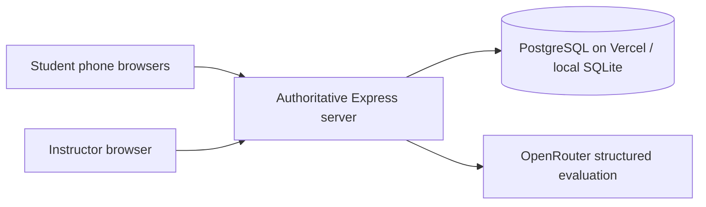

# PRD — cquiz

## 1. Overview

Run an in-person, automatically assessed conversational exam, capacity 100, using individual phone clients. Three rounds of 15 minutes, two five-minute transitions, configurable before start. Ranking is primary; retain raw insight points and component scores. Completion means tested application behavior; live readiness additionally requires provider credentials, HTTPS, and student-device preflight.

## 2. Technical Architecture

React/Vite frontend and same-origin Express API. Vercel uses PostgreSQL transactions, durable grading leases, request-driven deadlines and 2.5-second client polling. A local Node 24 persistent server uses built-in SQLite and server-sent notifications. Never deploy SQLite to ephemeral serverless storage. OpenRouter chat completions with strict JSON schema, require_parameters, data_collection deny and optional required ZDR. Model chosen/configured by instructor. Browser SpeechRecognition adapter sends text only.

## 3. Data Model

Versioned exam aggregates: settings, frozen bank, roster, sessions, groups by round, tables, invitations with explicit eligible and volunteered sets, responses with grading jobs and immutable transcript, peer ratings with original rank snapshots and current applied weights, private transition diagnostics, append-only audit events, current ranking and prior snapshots. Persist every accepted mutation atomically. Access sessions are random hashed tokens, cookies HttpOnly/SameSite. Session identity is server-authoritative.

## 4. API Specification

POST /api/admin/login; POST /api/logout; GET /api/me; GET /api/admin/state; POST /api/admin/import/{bank|roster}; POST /api/admin/exams; POST /api/admin/exams/:id/action; POST /api/admin/provider; POST /api/admin/provider/test; GET /api/admin/exams/:id/export; GET /api/admin/template/:type; POST /api/student/join; GET /api/student/state; POST /api/student/preflight; POST /api/student/volunteer; POST /api/student/finish; POST /api/student/rate; POST /api/student/flag; POST /api/student/diagnostics; GET /api/events. All mutations enforce session role, same-origin CSRF checks, bounded data and idempotency. No bank, grades, other emails or IDs in student payloads.

## 5. User Stories

Instructor: import validated data, configure weights, rehearse, run/pause/extend rounds, monitor flags and failed jobs, retry evaluations, recover sessions, download scores and evidence. Student: join roster entry, verify speech recognition, volunteer when eligible, see whose turn, see own readonly transcript, finish, privately rate peers, flag transcription, receive next-table instructions.

## 6. Functional Requirements

FR-001 weighted bank and roster CSV/XLSX with row-level validation; FR-002 password-protected administrator and per-exam participant sessions; FR-003 server timing, invitations and minimum-rank selection with rotating deterministic ties; FR-004 readonly speech text, explicit finish, flag annotations, no audio retention; FR-005 AI rubric evaluation with pending/error/retry states and no mock fallback; FR-006 three-item peer ratings required before next volunteering, normalized eligible opportunity count; FR-007 dynamic retrospective peer weights; FR-008 random and adaptive grouping of sizes three to five; FR-009 private ungraded appearance and fluency diagnostics; FR-010 points, rankings, evidence and recalculation exports; FR-011 recovery and readiness checks.

## 7. Non-Functional Requirements

100 concurrent clients; bounded 100-person recalculation; ranking updates after each accepted assessment; restart recovery; transaction protection and serialized writes; no raw student identifiers in AI requests. Input/file size limits, no executable uploads, rate-limited entry and administrator authentication, no client-provided student IDs for acting as others. Accessible labels, keyboard controls, 48px touch targets, reduced motion, no horizontal overflow at 320px.

## 8. UI/UX Requirements

Student: join, speech preflight, waiting, invitation, speaking, rating, transition, completed. No public points/ranks or peer ratings. Instructor: setup/imports, readiness, live table grid, standings, evidence drawer, controls, settings, exports. Empty/loading/error/success states. Tokens in docs/design.md.

## 9. Auth Implementation

ADMIN_PASSWORD configured privately or through initial local setup. Strong password hashing and timing-safe comparisons. Cookies secure in HTTPS deployments. School email/ID pair matched to roster; explicit warning in operator guide that this is an identity claim, with attendance verification by instructor. Prevent duplicate active sessions; instructor can release a participant session. Student sessions do not grant instructor access.

## 10. Payment Integration

None. API costs are external to the app; do not purchase credits.

## 11. Edge Cases & Error Handling

Speech unsupported/denied -> remain in preflight with specific guidance. Reconnect preserves session and accepted answers. AI timeout/invalid schema -> failed job, no invented scores, retry by instructor. Empty contribution stays unsubmitted. Duplicate submit/rating -> idempotent. No volunteers -> next question. No unseen question -> table shows bank exhausted, instructor alerted. Round closes active turn -> accepted completed text until transition action terminates it; no invitation counts during pause/disconnect/rating obligations. Results labeled provisional if grading jobs or mandatory ratings unresolved. Pause stores remaining time. Restart marks in-flight evaluations pending for retry, not double credit.

## 12. Dependencies & Integrations

React, Express, Vite, TypeScript, ExcelJS, PapaParse, Multer, Zod, Phosphor icons, self-hosted Manrope. OpenRouter model probe enforces the exact production schema/routing. No audio API fallback in first version; require supported phone browsers and preflight.

## 13. Out of Scope

In-app question generation, virtual audio/video, official grades, model validity claims, public deployment without approval, third-party analytics.

## 14. Open Questions

No unresolved product decisions. Operator must privately configure OpenRouter model/key and the classroom HTTPS host, upload actual approved course bank/roster, and rehearse supported physical devices. Scoring protocol details are implementation defaults documented in scoring.md and frozen per exam.
